# eio-chaos

Chaos tests of [Eio](https://github.com/ocaml-multicore/eio) programs, on
simulated devices that fail together.

An Eio program receives the outside world as values, such as `env#fs` and
`env#net`. `eio-chaos` builds that `env` from simulated devices, called
parts, runs the program on it many times, and in each run gives a part a
fault or cuts the power. After each fault it restarts the program on what
the fault left ([How it works](#how-it-works)).

The parts come from other packages:
[eio-fs](https://github.com/samoht/ocaml-eio-fs) gives a disk,
`Eio_fs_chaos.disk ()`, and
[eio-net](https://github.com/samoht/ocaml-eio-net) a network,
`Eio_net_chaos.network ()`. This README uses a toy one,
`Eio_chaos_toy.resolver ()`, to try the check and to read as an example of
a part. It is not installed: [Writing a part](#writing-a-part) shows its
whole source.

## Installation

<!-- $MDX skip -->
```sh
opam install eio-chaos
```

## Testing a program

`Eio_chaos.run parts main` runs `main` with an `env` built from `parts`.
`main` takes `env` and reads it with the `Eio.Stdenv` accessors, as it does
under `Eio_main.run`, so the program is not changed. This one looks up its
database through the toy resolver, and gives up when the lookup fails:

```ocaml
# let main (env : Eio_chaos.env) =
    match Eio.Net.getaddrinfo_stream (Eio.Stdenv.net env) "db" with
    | _ -> ()
    | exception Eio.Io _ -> failwith "no database";;
val main : Eio_chaos.env -> unit = <fun>
# match Eio_chaos.run [ Eio_chaos_toy.resolver () ] main with
  | () -> print_endline "passed"
  | exception Failure report -> print_endline report;;
Eio_chaos.run: the program failed under a fault
  faults:   #1 lookup db times out
  error:    Failure("no database")
  trace:
    #1 lookup db  <- times out
  replay:   Eio_chaos.run ~replay:"dns/355f1c0e/lookup:1.timeout" parts app
- : unit = ()
```

The first lookup timed out, and the program raised an exception of its own.

A report is the text of a `Failure`. In a program that sets up its outputs
with `Console_tty.setup ()`, from
[console](https://github.com/samoht/ocaml-console), a report left uncaught
prints on a terminal in the colours of console's theme, so the title, the
faulted operation and the replay line stand out. On a pipe, in a CI log,
under `dune test`, with `NO_COLOR` set or with `TERM=dumb`, it prints as the
text above.

<!-- $MDX file=test/uncaught/fail.ml -->
```ocaml
(* A program whose check fails, its report left uncaught. *)

let () =
  Console_tty.setup ();
  Eio_chaos.run
    [ Eio_chaos_toy.resolver () ]
    (fun env ->
      match Eio.Net.getaddrinfo_stream env#net "db" with
      | _ -> ()
      | exception Eio.Io _ -> failwith "no database")
```



The first run has no fault. Each later run starts from the same state and
meets the faults that a part allows at an operation of the program:

- one operation fails, as a write with `ENOSPC`, or two in one run, on one
  part or across two;
- a read or a write fails part of the way through, as a connection reset
  after the bytes of the first of two messages;
- a condition holds from one operation on, as a disk that is full;
- the power is cut after an operation that changes what a part keeps, or at
  the end, and each part keeps what a cut may leave: the disk keeps what was
  synced, and some or all of the rest.

After each of those runs, every part is restarted, and the program runs
again with no fault on what the parts kept, as a machine restarts a service.

The check fails if a run hangs, if it raises anything other than `Eio.Io` or
what a part says its faults raise (eio-net: `End_of_file` and
`Eio.Time.Timeout`), if a part lost something it promised, as a file the
program acknowledged with `Eio_fs_chaos.ack`, or if the restart fails. An
`Eio.Io` that escapes a run with a fault is not a failure in itself: the
device did fail, so the restart decides. The check also fails if the program
makes no operation on a part, as it then tests nothing.

The report gives the fault, the operations of the run on every part, what
the program printed, the error, and one line to paste, which runs that case
alone. A run meets at most two faults, so a program that tries three times,
with a pause between tries, passes:

```ocaml
# let rec lookup (env : Eio_chaos.env) n =
    match Eio.Net.getaddrinfo_stream env#net "db" with
    | addrs -> addrs
    | exception Eio.Io _ when n > 0 ->
        Eio.Time.sleep env#clock 1.;
        lookup env (n - 1);;
val lookup : Eio_chaos.env -> int -> Eio.Net.Sockaddr.stream list = <fun>
# Eio_chaos.run [ Eio_chaos_toy.resolver () ] (fun env -> ignore (lookup env 2));;
- : unit = ()
```

The sleep takes no time, as the run's clock jumps to the next timer.

Several parts make one `env`, and each run fails one of them, or two in a
pair. The README of [eio-fs](https://github.com/samoht/ocaml-eio-fs#testing-a-program)
tests a program that saves a file and serves it to a client, on the disk
of eio-fs and the network of eio-net at once. To simulate a part without
making it fail, wrap it in `Eio_chaos.quiet`.

## Writing a part

A part is a module of type `Eio_chaos.PART`, given to `Eio_chaos.Part`. This
is the whole source of the toy resolver, a part that gives `env#net`:

<!-- $MDX file=lib/toy/eio_chaos_toy.ml -->
```ocaml
open! Hermetic

type fault = Timeout | Refused

let fault_name = function Timeout -> "timeout" | Refused -> "refused"

let pp_fault ppf = function
  | Timeout -> Fmt.string ppf "times out"
  | Refused -> Fmt.string ppf "is refused"

type Eio.Exn.err += Toy of string

let () =
  Eio.Exn.register_pp (fun ppf -> function
    | Toy e ->
        Fmt.pf ppf "Toy %s" e;
        true
    | _ -> false)

type t = { mutable chaos : Eio_chaos.t }

module Net = struct
  type nonrec t = t
  type tag = [ `Generic ]

  let refuse () = raise (Eio.Exn.create (Toy "not supported"))
  let listen _ ~reuse_addr:_ ~reuse_port:_ ~backlog:_ ~sw:_ _ = refuse ()
  let connect _ ~bind_to:_ ~options:_ ~sw:_ _ = refuse ()
  let datagram_socket _ ~reuse_addr:_ ~reuse_port:_ ~sw:_ _ = refuse ()
  let getnameinfo _ _ = refuse ()

  let getaddrinfo t ~service:_ host =
    let op = Eio_chaos.Op.v ~device:"dns" ~kind:"lookup" ~changes:Never host in
    match
      Eio_chaos.decide t.chaos op ~name:fault_name ~pp:pp_fault
        [ Timeout; Refused ]
    with
    | Some f -> raise (Eio.Exn.create (Toy (fault_name f)))
    | None ->
        Eio_chaos.spend t.chaos Mtime.Span.(1 * ms);
        [ `Tcp (Eio.Net.Ipaddr.V4.loopback, 80) ]
end

let net t = Eio_chaos.Net (Eio.Resource.T (t, Eio.Net.Pi.network (module Net)))

module Part = Eio_chaos.Part (struct
  type nonrec t = t

  let name = "dns"
  let noun = "lookup"

  let start t ~os:_ ~sw:_ ~clock:_ ~mono_clock:_ chaos =
    t.chaos <- chaos;
    net t

  let run t ~cut:_ ~faults:_ = net t
  let cut _ = []
  let restart t ~power:_ ~cut:_ = net t
  let pp_op = Eio_chaos.Op.pp
  let indeterminate _ = false
end)

let resolver () = Part.v { chaos = Eio_chaos.none }
```

- At each operation, the device asks `Eio_chaos.decide` whether the
  operation fails, with the faults the kernel allows there, and acts out the
  answer. In production it passes `Eio_chaos.none`, which never fails
  anything.
- `Eio_chaos.Op.v` describes the operation: its part, its kind, its target
  and whether it changes what the part keeps across a power cut. A lookup
  changes nothing. Its optional arguments say what only some parts know,
  such as the offset and length of a write.
- `start` makes the part new for each run: it forgets what an earlier run
  left and takes the run's `chaos`, which is all the resolver holds. It is
  the capability that `~setup` gets. A part gives one capability, `Eio_chaos.Fs (fs, cwd)` for `env#fs`
  and `env#cwd`, or `Eio_chaos.Net net` for `env#net`. The others stay
  refused.
- `run` is the capability the program gets, on what `~setup` left.
- `cut` cuts the power and gives lines for the report. `restart ~power` is
  the capability of the program started again, on what survives a restart
  or a power cut. A part with state, as the disk of eio-fs, calls
  `Eio_chaos.lost` there for each promise it broke. The resolver keeps
  nothing, so both are trivial.
- `indeterminate` says what a program may raise, other than `Eio.Io`, when
  an operation of the part fails, as `End_of_file` on a stream.

A device the program builds from `env` takes `env#chaos` to ask the same
question. [`eio_chaos.mli`](lib/eio_chaos.mli) documents the rest, such as a
fault that lands inside a read, and the many connections of a server that
the check thins.

## How it works

### Chaos engineering, on one machine

Chaos engineering runs a system, injects the faults the real world
produces, and tries to disprove a hypothesis about its steady state.
`Eio_chaos.run` does this in one process, deterministically:

- **steady state:** the program returns, and when it is restarted on what a
  fault left, it starts and works again, and no part lost what it promised;
- **faults:** each fault a part allows at each operation the program made,
  and a power cut;
- **result:** either the hypothesis held for every fault tried, or the first
  counter-example and one line that replays it.

Each part proposes, at each operation, the faults the kernel allows there,
and how to thin many operations alike, such as the writes of one log or the
connections of a server: the check takes the first three, the last, and the
first of each size. The runner then tries them in two tiers:

1. The linear tier runs whole: each fault at each operation it keeps, and a
   power cut after each change, in its two simplest states, every unsynced
   change lost or every one kept. If the tier needs more runs than
   `~budget` (20,000 by default), the check fails rather than pass on part
   of it.
2. The sampled tier spends a fortieth of the budget, or half as much as the
   linear tier if that is more, on runs drawn from `~seed`: the other
   operations, pairs of faults, on one part or across two, power cuts
   during the restart, and the other states a cut may leave. A second fault
   goes first to the changes on the path the first one opened.

Adding a part adds its runs to the total: it does not multiply them. A pass
means that no counter-example was found among the faults tried.

Two runs with no fault must make the same kinds of operation in the same
order, as a fault is aimed by its kind and its place among those of its
kind; where only the names differ, a report says where. A run that retries a
failed operation at once spins: it fails as a hang once it retries 10,000
times more than the first run made it, with no time passing. Operations take
time on the run's clock, a sync 1 ms in eio-fs, so a fiber that waits on a
timer still runs.

`~replay` reruns one reported case. Two checks with the same seed make the
same runs and print the same report.

### What is simulated

`env` has every method of `Eio.Stdenv`, each simulated:

- `fs`, `cwd` and `net` come from the parts. A capability no part gives
  raises `Eio.Io` at each operation;
- `clock` and `mono_clock` start at 0 and jump to the next timer when every
  fiber waits, so a sleep takes no time;
- `secure_random` and OCaml's default `Random` are seeded, the same in each
  run, whatever `~seed`, so a replay needs none;
- `stdin` is empty, and `stdout`, `stderr` and `Eio.traceln` are kept for the
  report;
- `domain_mgr` runs its work in the run's own event loop;
- `process_mgr` refuses to start a process;
- `backend_id` is `"chaos"`;
- `chaos` is the run's `Eio_chaos.t`, for a device the program builds itself.

```ocaml
# Eio_chaos.run [] (fun env ->
    Eio.Time.sleep env#clock 60.;
    assert (Eio.Time.now env#clock >= 60.));;
- : unit = ()
```

The check controls what the program reaches through `env`. A direct call to
`Unix`, `open_in`, `Random.self_init` or `Domain.spawn` escapes it.
[hermetic](https://github.com/samoht/ocaml-hermetic) makes the compiler
reject those calls: start each source file with `open! Hermetic`, as the toy
resolver does. This holds for programs and for parts alike.

### What is guaranteed

1. A check is deterministic: the same program, parts and seed make the same
   runs, so the replay line of a report runs that case again.
2. Each fault is one a part proposed. The parts of eio-fs and eio-net
   propose only what the real kernel can return at that call, checked
   against recordings of Linux and macOS, so every fault they report can
   happen on a real machine.
3. Completeness is not guaranteed. Faults fall only on the operations the
   program made in its first run, at most two per run, or one condition. A
   pass means no counter-example was found there.

## Limitations

- A part gives `env#fs` and `env#cwd`, or `env#net`: one part each.
- Faults fall only on the operations the program made in its first run, at
  most two per run, or one condition.
- `Eio_unix.Stdenv.base` is not provided: `env` has the generic Eio types.

## Related work

FoundationDB, TigerBeetle, turmoil and madsim run disk and network in one
deterministic simulation with one source of choices; `Eio_chaos.decide` is
that source here. The linear tier enumerates faults, as ALICE and
CrashMonkey enumerate crash states. The event loop is a copy of
`Eio_mock`'s, with a clock that prints nothing and stops a run that hangs.

## Licence

ISC, see [LICENSE.md](LICENSE.md).
